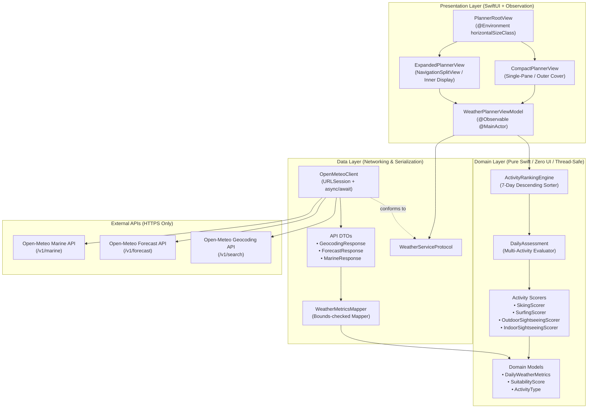
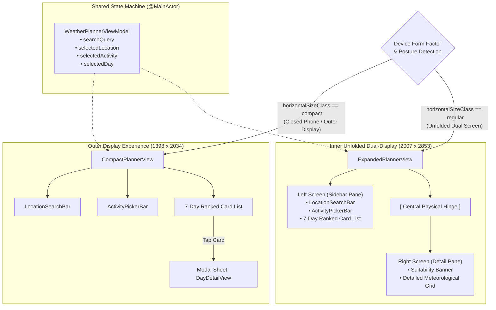
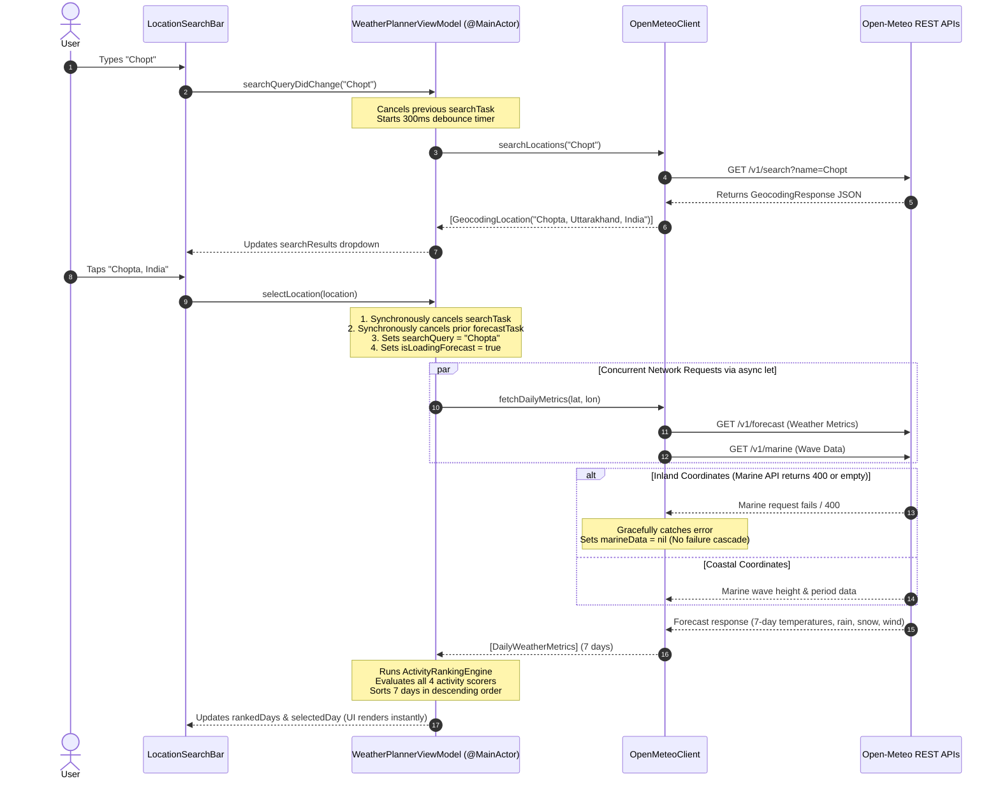
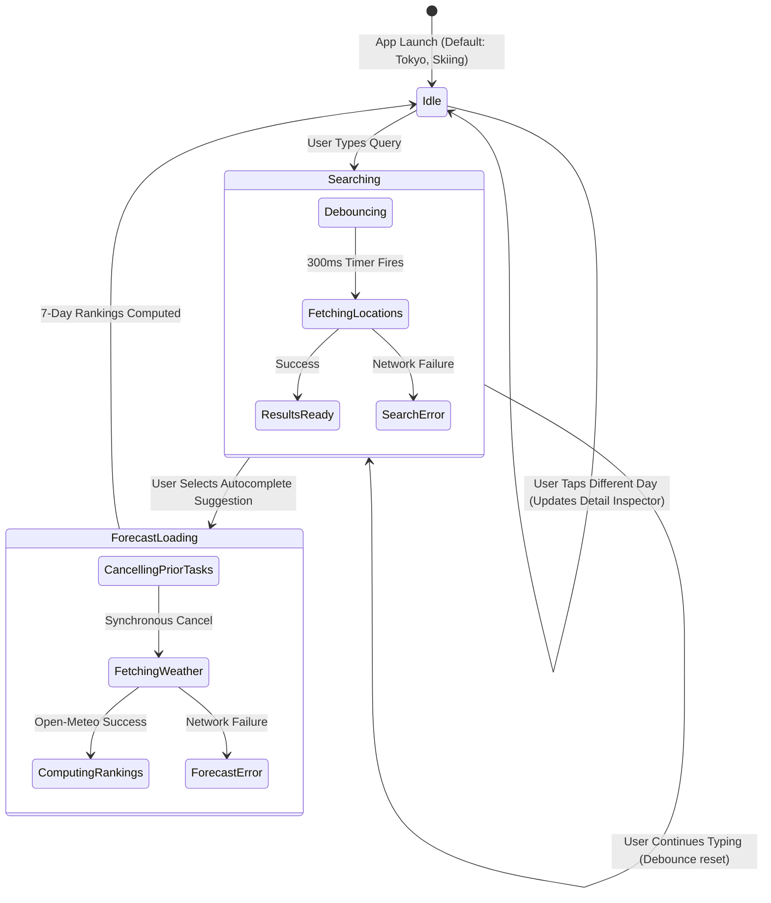

# SmartWeather — Architecture & System Overview Diagrams

This document contains visual architectural diagrams for **SmartWeather** rendered using standard GitHub-compatible [Mermaid](https://mermaid.js.org/) syntax. You can view these directly on GitHub, in VS Code/Xcode markdown previewers, or in any Mermaid-compatible viewer.

---

## 1. High-Level System Architecture & Clean Architecture Data Flow

---

## 2. iPhone Duo Adaptive Layout & State Continuity

---

## 3. Asynchronous Data Flow & Race Condition Safeguards

---

## 4. ViewModel State Machine

