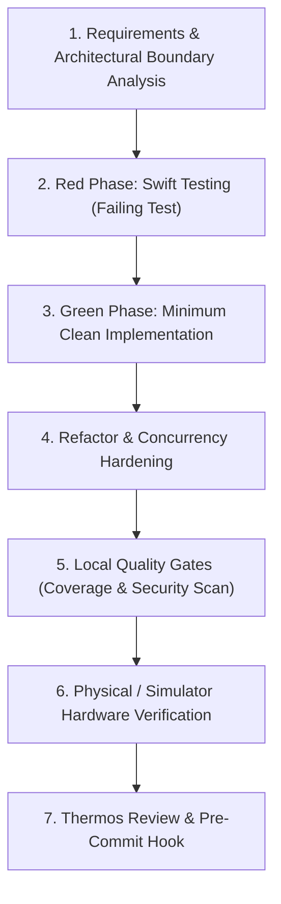

# SmartWeather — Senior Engineering Workflow & Standards

This document establishes the end-to-end engineering workflow, architectural standards, quality gates, and security practices used to develop and maintain **SmartWeather**. It is designed as both an onboarding runbook for team members and a reference for technical leadership.

---

## 1. Core Engineering Philosophy

We operate with a **Staff / High-Assurance Engineering Mindset**:
1. **System Thinking Over Syntax**: Every decision must account for the whole system: state continuity, data race safety, hardware constraints (foldable dual screens), and offline resilience.
2. **Small, Independently Reviewable Increments**: Features and fixes are broken down into isolated, single-responsibility commits that pass all quality gates independently.
3. **Honest Verification Over Assumptions**: We never infer that a test passes, a simulator works, or a setting is active without direct programmatic verification.
4. **Zero Third-Party Binary Bloat**: Prefer native Apple SDKs (`SwiftUI`, `Observation`, `Swift Concurrency`, `Swift Testing`, `URLSession`) over external dependencies that add supply-chain and maintenance risks.

---

## 2. End-to-End Feature Development Cycle

Every new feature or bug fix follows a strict 7-phase loop:



### Phase 1: Requirements & Architectural Boundary Analysis
- **PStack Separation**: Decide which layer owns the logic:
  - **Domain**: Pure business rules, scoring math, deterministic sorting. *Never imports SwiftUI, UIKit, or URLSession.*
  - **Data**: REST API DTOs, network requests, error mappings.
  - **Presentation**: `@Observable` ViewModel coordinating user input, search debouncing, task cancellation, and view bindings.
- **Dependency Inversion**: Any external interaction (networking, persistence) must be defined as a protocol in the Domain/Data layer to allow test double injection.

### Phase 2: Red Phase (Apple Swift Testing)
- Write unit tests using Apple's modern **Swift Testing** framework (`import Testing`), **never legacy XCTest**.
- Use descriptive `@Suite` and `@Test("Human-readable specification")` declarations.
- Assert using `#expect(...)` (soft assertion) and `#require(...)` (hard precondition check).
- **Verify the test fails for the expected reason** before writing production code (`./Tools/run-domain-tests.sh`).

### Phase 3: Green Phase (Minimum Clean Implementation)
- Write the minimal code required in Domain, Data, or ViewModel to make the test pass cleanly.
- Verify tests pass with sub-second execution time.

### Phase 4: Refactor & Concurrency Hardening
- Apply **Swift 6 Strict Concurrency** principles:
  - Isolate UI-facing state to `@MainActor`.
  - Ensure all domain entities conform to `Sendable`.
  - Mitigate race conditions by synchronously cancelling previous in-flight `Task` handles before starting new asynchronous operations.
- Extract duplicated styling into reusable components (e.g., [`SuitabilityBadgeView`](file:///Users/provider.op/orca/workspaces/SmartWeather/scratch-1/SmartWeather/Presentation/Views/Components/SuitabilityBadgeView.swift)) and semantic tokens ([`Color+AppTheme.swift`](file:///Users/provider.op/orca/workspaces/SmartWeather/scratch-1/SmartWeather/Presentation/Views/Components/Color+AppTheme.swift)).

### Phase 5: Local Quality Gates (Coverage & Security)
- Run `./Tools/run-coverage.sh`: Verify LLVM line coverage meets or exceeds our **88% baseline**.
- Run `./Tools/run-security-scan.sh`: Run secret scans, ATS HTTPS audits, MobSFScan, and `duo-lint`.

### Phase 6: Hardware Simulation & Dual-Display Verification
- Compile and deploy to the target hardware/simulator:
  ```bash
  DEVELOPER_DIR=/Applications/Xcode-27.1.0-Release.Candidate.app/Contents/Developer xcodebuild -project SmartWeather.xcodeproj -scheme SmartWeather -destination 'id=<DEVICE_UUID>' build
  ```
- Verify dual-display rendering on the **iPhone Duo** in Apple's `DeviceHub.app`.
- Capture outer (1398×2034) and inner (2007×2853) framebuffer screenshots.

### Phase 7: Thermos Review & Pre-Commit Gate
- Conduct the 5-point Thermos review (see §4).
- Execute `git commit`. The automated `.githooks/pre-commit` gate verifies all tests and security checks before allowing the commit object into git history.

---

## 3. Specialized Skills Ecosystem

We manage and invoke modular community agent skills following **OWASP Agentic Skills Top 10** guidelines (limiting permissions, inspecting provenance, and pinning versions in `skills-lock.json`):

| Skill | Source / Package | Purpose in Our Workflow |
| :--- | :--- | :--- |
| **`swift-concurrency`** | `avdlee/swift-concurrency-agent-skill` | Guides Swift 6 language mode, actor isolation, structured task cancellation, and elimination of data-race warnings. |
| **`swift-testing-expert`** | `avdlee/swift-testing-agent-skill` | Enforces Apple Swift Testing patterns (`@Suite`, `@Test`, traits, parameterized testing, `#expect`/`#require`). |
| **`diagram-design`** | `cathrynlavery/diagram-design` | Generates editorial-grade HTML + inline SVG architectural schematics without generic templates or unreadable connectors. |
| **`agy-customizations`** | Antigravity Built-in | Reference for rule loading, precedence, hooks, and local workspace customizations. |

### Installing New Skills
Skills are installed project-locally using the universal `skills` CLI:
```bash
npx skills@latest add <owner>/<repo> --skill <skill-name> -y
```
All skills and their content hashes are tracked in [`skills-lock.json`](file:///Users/provider.op/orca/workspaces/SmartWeather/scratch-1/skills-lock.json).

---

## 4. The Thermo-Nuclear ("Thermos") Review Protocol

Before closing any significant task or checkpoint, we conduct a **Thermos Review** evaluated against 5 senior engineering teaching points:

1. **Problem Solved**:
   - The exact defect or requirement addressed, supported by reproduction logs or failing tests.
2. **Design Rationale**:
   - Why this specific architecture or data structure was selected over alternative approaches.
3. **Alternatives Rejected**:
   - Specific designs, third-party libraries, or design patterns considered and rejected, along with the concrete reasons for rejection (e.g., rejecting heavy DI containers in favor of constructor injection; rejecting `ObservableObject` in favor of `@Observable`).
4. **What Tests Prove and Do NOT Prove**:
   - An honest boundary analysis. For instance: *"Unit tests prove deterministic sorting and score calculation; they do not prove that Open-Meteo's remote servers have 100% uptime."*
5. **Key Architectural Takeaway**:
   - A generalizable heuristic or design principle for the team's ongoing knowledge base.

---

## 5. Mobile Security & DevSecOps Practices

Security is shifted completely to the left and runs as part of daily local development rather than waiting for CI/CD or post-release penetration tests.

### Security Gates Enforced in `./Tools/run-security-scan.sh`:
1. **Zero Hardcoded Secrets**:
   - Automated regex scanning across staged code for private keys, AWS/cloud tokens, Bearer tokens, and API credentials.
2. **Strict App Transport Security (ATS)**:
   - Verification that 100% of network URLs use `https://` schemes (zero cleartext HTTP).
3. **MobSFScan Static Application Security Testing (SAST)**:
   - Scans Swift and plist source files against the **OWASP Mobile Application Security Verification Standard (MASVS)** (CWE-319 Insecure Communications, CWE-919 Keyboard Cache, etc.).
4. **iPhone Duo Guideline Linter (`duo-lint`)**:
   - Enforces dual-screen guidelines DUO001 through DUO009:
     - Rejects hardcoded full-screen coordinates (`UIScreen.main.bounds`).
     - Enforces adaptive SwiftUI size classes.
     - Enforces safe area and hinge margin clearance.

---

## 6. Git Pre-Commit Hook Automation

To guarantee that broken tests or security vulnerabilities can **never be committed to version control**, we enforce a tracked pre-commit hook:

- **Hook Path**: [`.githooks/pre-commit`](file:///Users/provider.op/orca/workspaces/SmartWeather/scratch-1/.githooks/pre-commit)
- **Activation Command**:
  ```bash
  git config core.hooksPath .githooks
  ```
- **Execution Pipeline**:
  ```bash
  #!/usr/bin/env bash
  set -euo pipefail
  
  echo "▶ Running Swift Testing test suites..."
  ./Tools/run-domain-tests.sh
  
  echo "▶ Running Security & Conformance checks..."
  ./Tools/run-security-scan.sh
  ```
If either test execution or security scanning exits with a non-zero code, the commit is aborted immediately.

---

## 7. Tooling & Test Runner Runbook

All developer workflows are accessible via dedicated scripts in the [`Tools/`](file:///Users/provider.op/orca/workspaces/SmartWeather/scratch-1/Tools/) directory:

| Script | Command | Purpose | Average Runtime |
| :--- | :--- | :--- | :--- |
| **Fast Test Runner** | `./Tools/run-domain-tests.sh` | Compiles domain and unit tests on macOS with Swift Testing | ~0.05 seconds |
| **Code Coverage Tool** | `./Tools/run-coverage.sh` | Instruments tests with LLVM profiling and prints coverage table | ~0.06 seconds |
| **Security Scanner** | `./Tools/run-security-scan.sh` | Secrets scan + ATS check + duo-lint + MobSFScan | ~1.5 seconds |
| **Demo Video Recorder** | `./Tools/record-demo.sh` | Captures H.264 video recordings of iPhone Duo simulator displays | User-controlled |
| **SVG Diagram Exporter** | `python3 .agents/skills/diagram-design/scripts/export_svg.py <input.html> <output.svg>` | Exports standalone scalable SVG from diagram HTML | ~0.2 seconds |

---

## 8. Summary Checklist for Senior PR Reviews

Before submitting a Pull Request, verify:
- [ ] New behavior is covered by a Swift Testing test (`@Suite`, `@Test`).
- [ ] `./Tools/run-domain-tests.sh` passes 100% cleanly in `< 0.1s`.
- [ ] `./Tools/run-coverage.sh` maintains overall line coverage $\ge 88\%$.
- [ ] `./Tools/run-security-scan.sh` reports 0 secrets, 0 ATS violations, and 0 duo-lint findings.
- [ ] State mutations in ViewModel are isolated to `@MainActor`.
- [ ] Asynchronous task cancellations prevent race conditions on rapid user inputs.
- [ ] Layout renders correctly on both compact cover screen and expanded dual-display canvas.
- [ ] Commit message follows Conventional Commits format (`feat:`, `fix:`, `docs:`, `refactor:`, `test:`).
